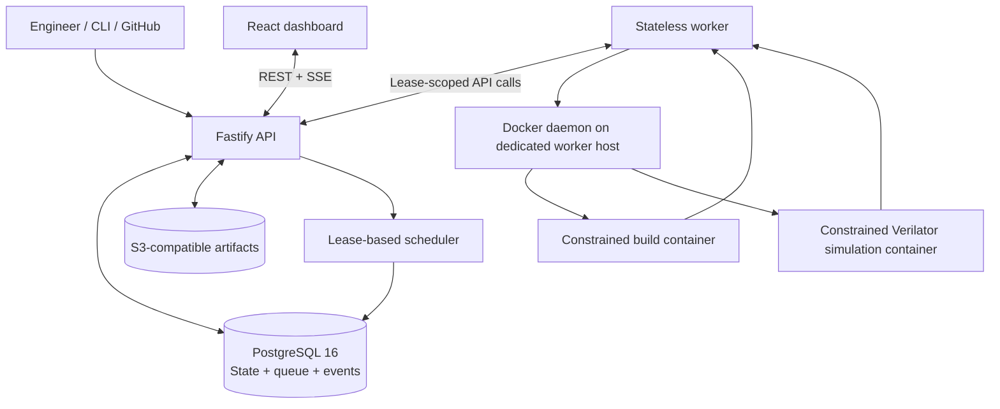
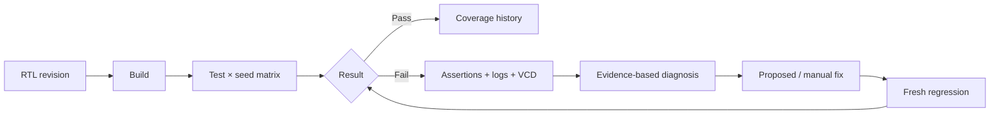

<div align="center">

# VerifyCloud

### Hardware verification, with the engineering discipline of modern CI.

**Self-hosted RTL regression orchestration · isolated Verilator execution · coverage & waveforms · evidence-first debugging**

[](LICENSE)


**[Quick start](#quick-start) · [How it works](#architecture) · [Verification workflow](#verification-workflow) · [Security](#security--trust-boundaries) · [Benchmarks](#measured-performance) · [Documentation](#documentation)**

</div>

> [!IMPORTANT]
> **Deployment status:** VerifyCloud is an internally validated beta, **not a production service**. The 2026-10-14 audit ran the suite on GitHub-hosted CI, against real MinIO, and through `docker compose up` with the official PostgreSQL image and a pinned MinIO build; gVisor was partly verified. **A real GitHub App, LLM providers and a production deployment remain unverified.** See [AUDIT_2026-10-14](verifycloud/docs/AUDIT_2026-10-14.md) and the [requirements matrix](verifycloud/docs/REQUIREMENTS_MATRIX.md).

## Why VerifyCloud?

Software teams expect every pull request to be built, tested and explained. RTL verification deserves the same workflow—without treating arbitrary HDL or testbenches as trusted code.

VerifyCloud turns SystemVerilog regressions into repeatable jobs, runs each build and simulation in a constrained container, and collects the evidence needed to understand failures: **test, seed, assertion, source location, logs, waveform context, and coverage changes**. Its deterministic analyzer works without an LLM; optional model-assisted analysis is explicitly opt-in.

### At a glance

| | |
|---|---|
| **Simulator** | **Verilator 5.020 only**; no UVM or commercial simulator support |
| **Execution** | Container-per-build/run; task leases and stale-worker fencing |
| **Interfaces** | React dashboard, REST/OpenAPI, Server-Sent Events, CLI, GitHub App/Action code |
| **State** | PostgreSQL 16 for jobs, queue, events, authorization and usage |
| **Artifacts** | S3-compatible storage adapter for logs, coverage, waveforms and builds |
| **Debugging** | Evidence-based rules by default; optional redacted LLM context |
| **Status** | Internally validated beta; external integrations still need live verification |

## Features

| Workflow | Capabilities |
|---|---|
| **Run regressions** | Named suites, test × seed expansion, cached builds, parallel runs, retries, flaky detection, cancellation, exact reruns |
| **Investigate failures** | Assertion and source-location extraction, searchable bounded logs, waveform inspection, run/branch comparisons |
| **Track verification** | Line/branch/toggle/functional coverage, per-job merging, history and coverage deltas |
| **Analyze evidence** | Deterministic diagnoses, optional LLM-assisted explanations, redaction previews, patch verification through fresh regressions |
| **Operate securely** | Organizations, owner/admin/engineer/viewer roles, scoped tokens, audit logs, quotas, retention, usage ledger |
| **Integrate workflows** | CLI, REST API, SSE, GitHub App/Action implementations, signed outgoing webhooks and email interfaces |
| **Observe the service** | Health/readiness endpoints, Prometheus metrics, structured logs and recovery tests |

## Architecture



**The API does not execute RTL.** Workers claim tasks through lease-scoped endpoints; they do not hold database or object-store credentials. PostgreSQL acts as both durable state store and queue. Task fencing prevents expired workers from committing stale results.

> [!NOTE]
> **Execution semantics:** VerifyCloud supports retryable, at-least-once physical execution with fenced/idempotent result recording. It does **not** guarantee exactly-once physical execution. See [ADR-008](docs/adr/) and [database design](docs/database.md).

Read the [architecture guide](docs/architecture.md), [database design](docs/database.md) and [ADRs](docs/adr/) for the tradeoffs.

## Quick start

### Requirements

- Linux host recommended; Docker Engine and Docker Compose
- At least ~4 GB free RAM for the local stack
- Git and a shell
- Network access to obtain required images and dependencies

```bash
# Clone your fork / repository
 git clone <YOUR_REPOSITORY_URL> verifycloud
 cd verifycloud

# Set real local credentials; do not commit .env
 cp .env.example .env

# Edit every CHANGE-ME value in .env before starting
# Provision the documented worker directory
 sudo mkdir -p /var/lib/verifycloud-worker

# Start the stack
 docker compose up --build
```

Open **http://localhost:8080** and sign in with the `DEMO_ADMIN_EMAIL` and `DEMO_ADMIN_PASSWORD` configured in `.env`.

> [!WARNING]
> The official-image Compose path was **not fully validated** in the supplied audit because required registries were inaccessible. A substitute-image Compose stack was tested, but that is not equivalent. Follow [deployment.md](docs/deployment.md) and validate the real stack before relying on it. Never expose the demo credentials or Docker worker host to the public internet.

For host-process development with existing PostgreSQL and S3-compatible storage, see [local development](docs/local-development.md).

## Verification workflow

### 1. Describe the RTL project

Create `verifycloud.yaml` in the design repository:

```yaml
version: 1
project: { name: my-ip }
rtl: { sources: ["rtl/**/*.sv"] }
testbench: { sources: ["tb/*.sv"], top: tb_top }
simulator:
  engine: verilator
  timing: true
  coverage: true
  waveform: on_failure
tests:
  smoke: {}
  random: { seeds: { range: [1, 20] } }
regressions:
  pr: { tests: [smoke] }
  full: { tests: [smoke, random] }
resources: { cpu: 2, memory_mb: 2048, timeout_seconds: 600 }
```

See the complete [verification configuration reference](docs/verification-model.md). Testbenches must be compatible with the supported Verilator backend; **UVM is not supported**.

### 2. Validate and run

```bash
verifycloud login --api http://localhost:8080
verifycloud validate
verifycloud run --project my-org/my-ip --regression pr --wait
verifycloud status <job-id>
verifycloud logs <task-id> --errors
verifycloud coverage <job-id>
```

The CLI supports reproducible reruns and artifact access; consult [CLI usage](docs/local-development.md) and [API reference](docs/api.md) for setup and supported operations.

### 3. Inspect the evidence



A passing simulation only establishes behavior covered by the supplied tests/assertions; it is **not proof that the RTL has no bugs**.

## Included AXI4-Lite demo

The synthetic demo intentionally contains a read-data stability defect: a register block derives read data from the live address rather than the address captured at handshake, allowing `RDATA` to change under back-pressure.

The documented end-to-end flow runs the seeded regression, identifies the assertion and RTL context, applies a reference correction, and verifies the correction with a **fresh run**. The demo regression was reported to move from **4/12 passing to 12/12 passing** after the fix.

Explore [`examples/axi4lite-demo`](examples/axi4lite-demo) and the [testing guide](docs/testing.md).

## Security & trust boundaries

VerifyCloud treats submitted RTL and testbenches as **untrusted executable workloads**. The worker's Docker execution configuration includes:

- No network access, non-root user, read-only root and inputs
- Dropped Linux capabilities, `no-new-privileges`, init/reaping
- CPU, memory, PID, disk, output and time limits
- Lease-scoped worker authorization and stale-result fencing
- Tenant-scoped access controls, hashed credentials and encrypted secrets
- Artifact file-type/symlink defenses and bounded upload memory

The October 2026 audit documented and remediated critical **artifact symlink disclosure** and **revoked-membership authorization** defects, along with additional scheduler and webhook security issues. Read the [security report](docs/audit-2026-10-08/security-report.md) rather than assuming the controls are a formal guarantee.

> [!CAUTION]
> Docker isolation is **not a VM-grade security boundary**. A worker has authority over its host Docker daemon. Use **dedicated worker machines** for untrusted workloads, keep the API/database off those hosts, and validate stronger runtimes before accepting arbitrary public submissions. Never deploy the simulation worker as an ordinary serverless function.

More: [security model](docs/security.md) · [threat model](docs/threat-model.md) · [worker hardening](docs/worker-security.md).

## Validation & test evidence

The supplied **October 2026 audit** reports the following results. These figures are audit artifacts, **not independently reproduced by this README author**.

| Validation | Reported result | Evidence |
|---|---:|---|
| Automated tests | **143 passed** | [Test report](docs/audit-2026-10-08/test-report.md) |
| Browser E2E | **2 passed** against host and substitute Compose deployment | [Test report](docs/audit-2026-10-08/test-report.md) |
| Scheduler claim benchmark | **0 duplicate claims across 8,080 claims** | [Benchmark report](docs/audit-2026-10-08/benchmark-report.md) |
| RTL mutation campaign | **9/10 mutations detected** | [Test report](docs/audit-2026-10-08/test-report.md) |
| Security remediation | Critical issues reproduced and regression-tested | [Security report](docs/audit-2026-10-08/security-report.md) |

**What this does not establish:** production readiness, absence of vulnerabilities, exactly-once physical execution, or live GitHub/MinIO/AWS/LLM compatibility.

### Reproduce locally

After provisioning the documented development dependencies:

```bash
npm ci
npm run typecheck
npm run test
npm run build
```

The `lint` script currently runs TypeScript checks; it is **not** a full ESLint/formatting gate. Integration tests require the services and permissions described in [testing.md](docs/testing.md).

## Measured performance

Audit measurements were collected on a **single 2-vCPU machine** with API, database, storage emulator, workers and load generator competing for resources. Results are workload-specific, not capacity promises.

| Metric | Reported measurement |
|---|---:|
| Scheduler claims, 1 / 5 / 10 / 25 workers | **46.4 / 65.5 / 68.8 / 64.4 tasks/s** (five-run means) |
| Real Verilator simulations, 1 / 5 / 10 / 25 slots | **119 / 208 / 206 / 215 runs/min** (demo workload) |
| Sandbox startup + teardown | **0.23 s median** |
| Demo build, cold / cached | **17.6 s / 0.015 s** |
| `GET /jobs/:id`, 10 concurrent clients | **784 requests/s; p95 19 ms** |

The older single-run scheduler figures were not consistently reproduced. The full methodology and uncertainty are documented in the [benchmark report](docs/audit-2026-10-08/benchmark-report.md) and [performance notes](docs/performance.md).

## Current limitations

- **Verilator 5.020 only**; no UVM, commercial simulator adapters or FST waveform support.
- **Real GitHub App, MinIO/AWS S3, external LLM providers and GitHub-hosted CI remain unverified**; existing adapter/mock tests do not replace live validation.
- **Official-image `docker compose up --build` remains unverified**; the audit validated a substitute-image stack.
- Scheduler contention limits throughput on the benchmark host; multi-host operation and gVisor/rootless isolation were not validated.
- Rule-based failure analysis is deliberately conservative; the audit's labeled evaluation reported **3 correct diagnoses, 25 abstentions and 0 incorrect diagnoses across 28 cases**.
- No SSO, payment-provider billing, formal verification job type or production SLA is claimed.

Track exact status in the [requirements matrix](docs/audit-2026-10-08/requirements-matrix.md).

## Roadmap

1. **Complete the reality gap:** official Compose images, real MinIO, real GitHub App/PR checks and GitHub Actions CI.
2. **Harden execution:** dedicated workers, gVisor/VM isolation tests, extended soak and multi-host failure testing.
3. **Improve verification depth:** close the remaining mutation-test gap; add FST, lint/formal jobs and simulator adapters where practical.
4. **Strengthen diagnostics:** expand the labeled failure corpus and measure real LLM providers before broadening AI claims.
5. **Validate adoption:** onboard external RTL users and prioritize observed failures over speculative features.

## Repository map

```text
packages/
  shared/        Shared contracts, schemas and utilities
  server/        Fastify API, scheduler, database, auth, integrations
  worker/        Task execution, Docker/Verilator and artifact handling
  cli/           Developer command-line interface
  web/           React dashboard
deploy/          Images and deployment support
examples/        AXI4-Lite verification demo
bench/           Benchmark and evaluation harnesses
action/          GitHub Action integration
.github/         CI workflow
docs/            Architecture, security, testing, ADRs and audits
```

## Documentation

| Area | Reference |
|---|---|
| Architecture and tradeoffs | [Architecture](docs/architecture.md) · [ADRs](docs/adr/) |
| Getting started | [Local development](docs/local-development.md) · [Deployment](docs/deployment.md) |
| RTL configuration | [Verification model](docs/verification-model.md) · [Simulator adapters](docs/simulator-adapters.md) |
| API and database | [API](docs/api.md) · [OpenAPI](docs/openapi.json) · [Database](docs/database.md) |
| Security | [Security](docs/security.md) · [Threat model](docs/threat-model.md) · [Worker security](docs/worker-security.md) |
| Diagnostics | [AI debugging](docs/ai-debugging.md) · [Observability](docs/observability.md) |
| Operations | [Testing](docs/testing.md) · [Performance](docs/performance.md) · [Troubleshooting](docs/troubleshooting.md) |
| Integrations | [GitHub integration](docs/github-integration.md) |
| Independent audit package | [October 2026 audit](docs/audit-2026-10-08/README.md) · [Requirements matrix](docs/audit-2026-10-08/requirements-matrix.md) |

## Contributing

Issues and pull requests are welcome. For substantial changes, include a minimal reproducer, regression tests, and a clear explanation of any security or compatibility impact. Review [testing](docs/testing.md) and [architecture](docs/architecture.md) before modifying scheduler, authorization, or sandbox boundaries.

## License

Released under the [MIT License](LICENSE). The included AXI4-Lite demo is synthetic and created for this repository.

---

<div align="center">

**VerifyCloud — make RTL failures reproducible, inspectable and actionable.**

</div>
