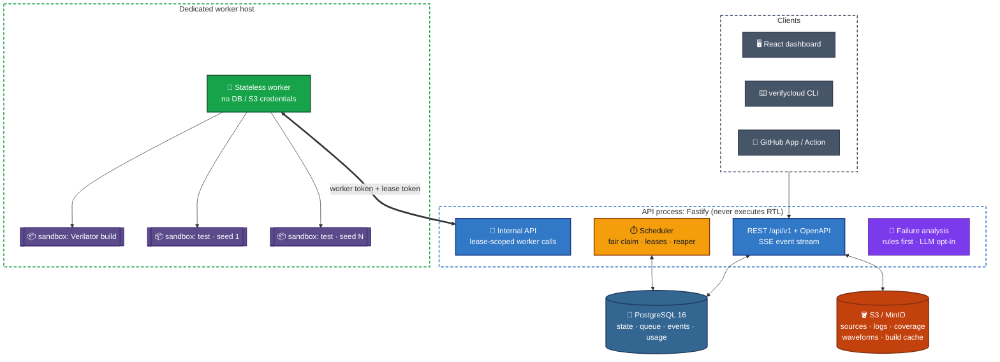
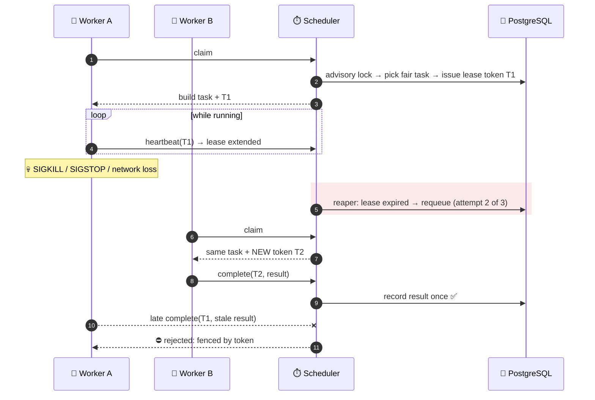
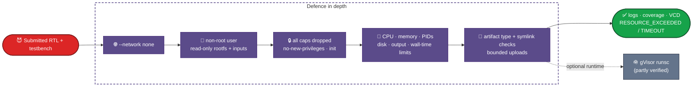
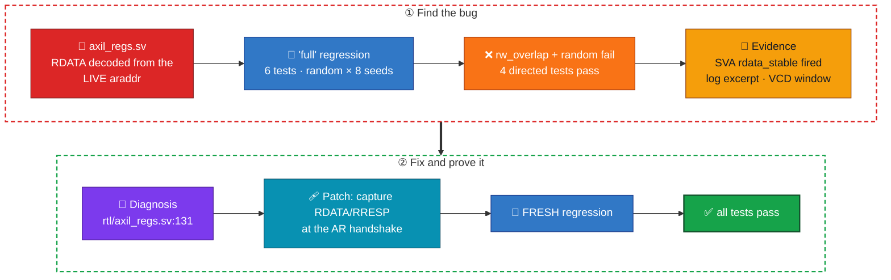
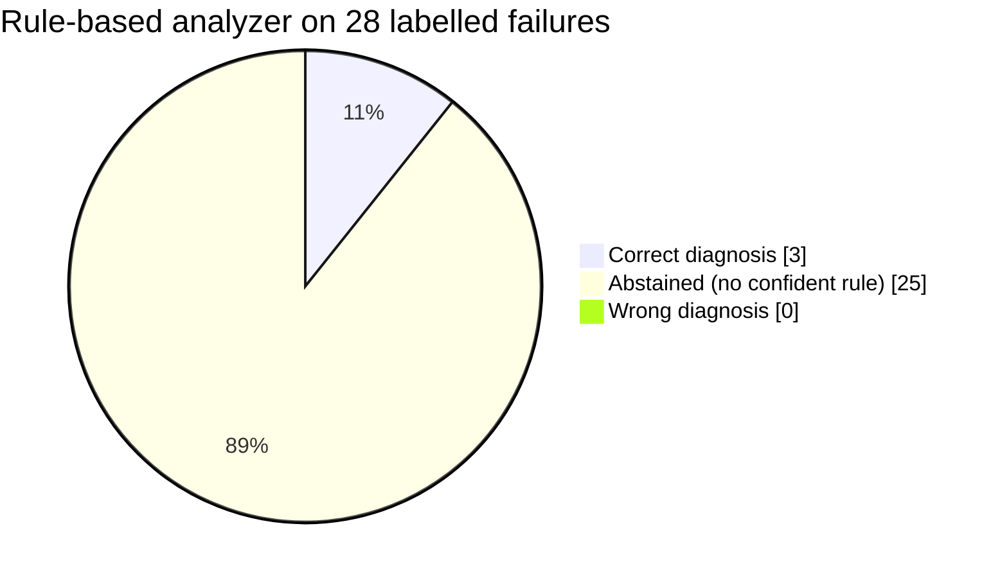
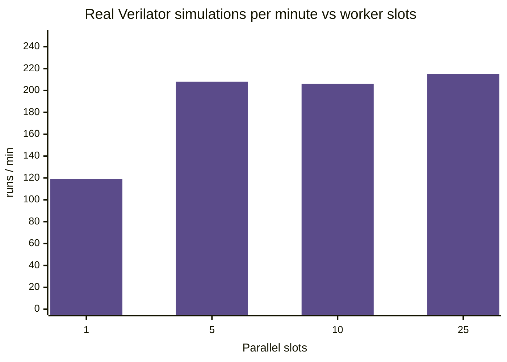

<div align="center">

# 🔬 VerifyCloud

### CI for hardware: self-hosted RTL regression orchestration that runs untrusted SystemVerilog in locked-down sandboxes and explains every failure with evidence

**Verilator regressions · test × seed matrices · coverage & waveforms · lease-fenced scheduler on PostgreSQL · container-per-run sandbox · evidence-first failure analysis**

<br/>


[](https://github.com/siddhaantxsingh/VerifyCloud/actions/workflows/ci.yml)


[**Why**](#-why-verifycloud) · [**Architecture**](#%EF%B8%8F-architecture) · [**Scheduler**](#-scheduler-leases--fencing) · [**Sandbox**](#%EF%B8%8F-the-sandbox-untrusted-rtl-is-untrusted-code) · [**Demo**](#-the-axi4-lite-demo-from-red-to-verified-green) · [**Evidence**](#-verification-evidence) · [**Quick start**](#-quick-start)

</div>

---

## 💡 Why VerifyCloud?

Software teams expect every pull request to be built, tested and explained. **RTL verification deserves the same workflow**, but a testbench is arbitrary code: it can `$fopen` host files, import libc through DPI-C, fork-bomb, or fill the disk.

VerifyCloud turns SystemVerilog regressions into repeatable jobs. It runs **each build and each simulation in its own constrained container** and collects the evidence an engineer needs to understand a failure: **test, seed, assertion, source location, log excerpt, waveform window and coverage delta.** Its failure analyzer is deterministic by default, and LLM help is strictly opt-in with redaction.

| | |
|---|---|
| 🔁 **Regressions** | Named suites, **test × seed expansion**, cached builds, parallel runs, retries, flaky detection, cancellation, exact reruns |
| 🔎 **Debugging** | Assertion + `file:line` extraction, searchable bounded logs, VCD waveform windows, run/branch comparison |
| 📈 **Coverage** | Line / branch / toggle / **functional (SVA cover)**, merged per job, with history and deltas |
| 🧠 **Analysis** | Rule-based diagnoses that **abstain instead of guessing**; optional LLM context preview; proposed patches verified by a **fresh regression** |
| 🏢 **Multi-tenant** | Orgs, owner/admin/engineer/viewer roles, scoped API tokens, audit log, quotas, retention, usage ledger |
| 🔌 **Integrations** | React dashboard · REST + OpenAPI · Server-Sent Events · CLI · GitHub App checks · GitHub Action · signed webhooks |

---

## 🏗️ Architecture



**Key boundaries:** the API never runs RTL. Workers hold **no database or object-store credentials**; they can only call lease-scoped internal endpoints. **PostgreSQL is both the durable state store and the queue** (no Redis; [ADR-002](verifycloud/docs/adr/ADR-002-postgres-queue.md), [ADR-003](verifycloud/docs/adr/ADR-003-no-redis-listen-notify.md)), with `LISTEN/NOTIFY` feeding the SSE event stream.

<details>
<summary><b>📦 Monorepo packages</b></summary>

<br/>

| Package | Responsibility |
|---|---|
| [`packages/server`](verifycloud/packages/server) | Fastify API, auth, tenancy/RBAC, scheduler, analysis, GitHub/webhook/email outboxes, metrics |
| [`packages/worker`](verifycloud/packages/worker) | Claims tasks, builds once, runs tests, enforces limits, uploads logs/coverage/waveforms |
| [`packages/shared`](verifycloud/packages/shared) | Config schema, coverage merging, SV indexer, VCD parser, patches, tar handling |
| [`packages/cli`](verifycloud/packages/cli) | `verifycloud` command-line client |
| [`packages/web`](verifycloud/packages/web) | React dashboard |
| [`action/`](verifycloud/action) · [`deploy/`](verifycloud/deploy) · [`examples/`](verifycloud/examples) | GitHub Action · images + Compose · AXI4-Lite demo |

</details>

---

## ⏱️ Scheduler: leases & fencing

Workers crash, stall, lose their network, or come back from a `SIGSTOP` minutes later. The scheduler is designed so that **a result is recorded exactly once, even though a run may execute more than once** ([ADR-008](verifycloud/docs/adr/ADR-008-leases-fencing-idempotency.md)).



- **Idempotent completion:** a retried completion after a lost response returns the recorded outcome.
- **Trusts the database clock, not the worker's:** worker-reported durations are clamped to the lease time measured on PostgreSQL. A clock step or a hostile worker used to cause negative usage, NaN, or a 500 that **lost the result**; that's fixed, with a failing-first test.
- **Retry policy:** infrastructure errors are retried; user errors (compile failures, failing tests, timeouts, resource limits) are not.
- **Verified with real processes:** `SIGKILL` mid-run, `SIGSTOP` past the lease (late writes refused, recorded result unchanged), ±2 h clock skew, and a 40-day clock step. **0 duplicate claims across 8,080 claims** in the contention benchmark.

---

## 🛡️ The sandbox: untrusted RTL is untrusted code

Every Verilator build and every test run gets **its own container** ([ADR-004](verifycloud/docs/adr/ADR-004-container-per-run-sandbox.md)):



**Adversarial RTL test suite (6/6):** host-file `$fopen` and `` `include ``, writes outside the run directory, **DPI-C imports bound to libc** (`system`, `unshare`, `setuid`), an elaboration-time infinite loop, and an oversized design. Earlier audits also found and fixed critical **artifact-symlink disclosure** and **revoked-membership authorization** bugs.

> [!CAUTION]
> Docker isn't a VM-grade boundary, and a worker has authority over its host's Docker daemon. Run workers on **dedicated machines**, keep the API and database off them, and validate gVisor or VM isolation before accepting public submissions. The output-flood budget is enforced by sampling and can overshoot (open finding F6). See [`worker-security.md`](verifycloud/docs/worker-security.md) · [`threat-model.md`](verifycloud/docs/threat-model.md)

---

## 🧪 The AXI4-Lite demo: from red to verified green

The [demo IP](verifycloud/examples/axi4lite-demo) has a deliberately planted AXI protocol bug. **The RTL contains no hint of it**, so any diagnosis has to come from the evidence.



`RDATA` must stay stable while `RVALID && !RREADY`. Under read back-pressure, the buggy slave lets it change when the master presents its next address, or when a write lands on the register being read. The testbench has **8 SVA assertions, 10 cover properties and a reference-model scoreboard**. The browser E2E test drives this entire loop (FAIL → analysis → patch → verified fix) against the Compose stack in CI.

<details>
<summary><b>📝 The project config (<code>verifycloud.yaml</code>)</b></summary>

<br/>

```yaml
version: 1
project: { name: axi4lite-demo }
rtl:       { sources: ["rtl/**/*.sv"] }
testbench: { sources: [tb/axil_checker.sv, tb/tb_top.sv], top: tb_top }
simulator:
  engine: verilator
  timing: true
  assertions: true
  coverage: { line: true, branch: true, toggle: true, functional: true }
  waveform: on_failure
tests:
  smoke:           { plusargs: { TEST: smoke } }
  rw_overlap:      { plusargs: { TEST: rw_overlap } }
  random:          { plusargs: { TEST: random, OPS: "400" }, seeds: { range: [1, 8] } }
  # … reset, wstrb, error_injection
regressions:
  smoke: { tests: [smoke, reset] }
  full:  { tests: [smoke, reset, wstrb, error_injection, rw_overlap, random] }
resources: { cpu: 2, memory_mb: 2048, timeout_seconds: 300 }
```

Full reference: [`verification-model.md`](verifycloud/docs/verification-model.md)

</details>

---

## 📊 Verification evidence

The 2026-10-14 audit tracks **22 requirements**: **16 VERIFIED · 3 PARTIAL · 2 BLOCKED** (they need the owner's GitHub App and an LLM key) · **1 NOT RUN** (benchmarks on a shared host). See [`REQUIREMENTS_MATRIX.md`](verifycloud/docs/REQUIREMENTS_MATRIX.md).

| Area | Result |
|---|---|
| ✅ **CI on GitHub-hosted runners** | Green: typecheck, build, full vitest suite against **real MinIO + Docker sandbox**, then **Compose stack + Playwright E2E** |
| ✅ **Official `docker compose up`** | `postgres:16.10` + MinIO + built images: demo regression fails exactly as designed, analysis points at `axil_regs.sv:131`, and **46/46 artifacts are byte-identical** after restarting MinIO, PostgreSQL and the API |
| ✅ **Recovery** | API restart, object-store outage and PostgreSQL restart mid-simulation → run recorded **once, on its first attempt** |
| ✅ **GitHub PR checks** (fake GitHub API) | App JWT, installation tokens, HMAC webhooks; **concurrent redeliveries create one job**; superseded PR runs are cancelled |
| ✅ **RTL mutation campaign** | **9/10** injected RTL bugs caught by the demo testbench (the survivor is documented) |
| 🟡 **gVisor runtime** | 5/6 sandbox tests + 2/2 adversarial tests pass; fork-bomb teardown took > 20 s |
| 🟡 **Output-flood bound** | Stopped, but overshoots the budget (122–154 MiB for 16 MiB) because it's sampled |

### 🐞 Found and fixed in the latest audit

| ID | Finding |
|:---:|---|
| F1 | **CI had never run.** The workflow sat in a subdirectory that GitHub ignores |
| F2 | 65 of 143 tests failed against real MinIO (hard-coded `test`/`test` credentials) |
| F3 | The pinned MinIO image had disappeared from Docker Hub, so Compose and CI couldn't start |
| F4 | Worker clock steps caused negative/NaN usage, or a 500 that **lost the result** → clamped on the DB clock |
| F5 | New pushes to a PR left superseded runs burning workers → now cancelled |

### 🧠 The analyzer abstains rather than guesses



<sub>Conservative by design: a wrong root cause wastes more engineering time than "I don't know, here's the evidence". See <a href="verifycloud/docs/ai-debugging.md"><code>ai-debugging.md</code></a> and <a href="verifycloud/docs/adr/ADR-007-ai-assistant-boundaries.md">ADR-007</a>.</sub>

### ⚡ Performance (previous audit; single shared 2-vCPU host)



| Metric | Measurement |
|---|---|
| Sandbox startup + teardown | **0.23 s** median |
| Demo build, cold → cached | **17.6 s → 0.015 s** |
| Scheduler claims, 1 / 5 / 10 / 25 workers | 46.4 / 65.5 / 68.8 / 64.4 tasks/s (five-run means) |
| `GET /jobs/:id`, 10 concurrent clients | **784 req/s**, p95 19 ms |

<sub>API, database, storage, workers and load generator all shared two cores, so throughput plateaus at the CPU. These are workload-specific numbers, not capacity promises, and weren't re-measured in the latest audit. See <a href="verifycloud/docs/performance.md"><code>performance.md</code></a>.</sub>

---

## 🚀 Quick start

**Requirements:** Linux · Docker Engine + Compose · about 4 GB free RAM

```bash
cd verifycloud
cp .env.example .env                       # edit every CHANGE-ME value
sudo mkdir -p /var/lib/verifycloud-worker  # worker scratch directory
docker compose up --build                  # → http://localhost:8080
```

Sign in with `DEMO_ADMIN_EMAIL` / `DEMO_ADMIN_PASSWORD` from `.env`. **Never expose the demo credentials or a worker's Docker host to the internet.**

```bash
verifycloud login --api http://localhost:8080
verifycloud validate                                   # check verifycloud.yaml locally
verifycloud run --project my-org/my-ip --regression full --wait
verifycloud status <job-id>
verifycloud logs <task-id> --errors
verifycloud coverage <job-id>
verifycloud artifacts <job-id> --download <artifact-id> --out wave.vcd
```

<details>
<summary><b>🛠️ Development</b></summary>

<br/>

```bash
cd verifycloud
npm ci
npm run typecheck
npm run test       # needs PostgreSQL, MinIO and Docker (see docs/testing.md)
npm run build
```

Host-process setup: [`local-development.md`](verifycloud/docs/local-development.md) · Deployment: [`deployment.md`](verifycloud/docs/deployment.md) · API: [`api.md`](verifycloud/docs/api.md) / [`openapi.json`](verifycloud/docs/openapi.json)

</details>

---

## 🧭 Design decisions

| ADR | Decision |
|---|---|
| [001](verifycloud/docs/adr/ADR-001-typescript-monorepo.md) | TypeScript monorepo |
| [002](verifycloud/docs/adr/ADR-002-postgres-queue.md) | **PostgreSQL as the queue**: advisory lock + `FOR UPDATE SKIP LOCKED`, fair share by org quota |
| [003](verifycloud/docs/adr/ADR-003-no-redis-listen-notify.md) | No Redis: `LISTEN/NOTIFY` for events |
| [004](verifycloud/docs/adr/ADR-004-container-per-run-sandbox.md) | **One container per build/run** |
| [005](verifycloud/docs/adr/ADR-005-verilator-adapter-harness.md) | Verilator adapter + harness |
| [006](verifycloud/docs/adr/ADR-006-object-storage-and-waveform-index.md) | Object storage + waveform index |
| [007](verifycloud/docs/adr/ADR-007-ai-assistant-boundaries.md) | **AI assistant boundaries**: rules first, opt-in redacted LLM |
| [008](verifycloud/docs/adr/ADR-008-leases-fencing-idempotency.md) | **Leases, fencing tokens, idempotent completion** |

More: [Architecture](verifycloud/docs/architecture.md) · [Database](verifycloud/docs/database.md) · [Security](verifycloud/docs/security.md) · [Observability](verifycloud/docs/observability.md) · [Scaling](verifycloud/docs/scaling.md) · [Audit 2026-10-14](verifycloud/docs/AUDIT_2026-10-14.md)

---

## ⚠️ Limitations

- **Validated beta, not a production service.** There's no production deployment or real users.
- **Verilator 5.020 only.** No UVM, no commercial simulators, no FST waveforms.
- **Live GitHub App and LLM providers are untested.** They're tested against a fake GitHub API and stubs, and need the owner's keys.
- **Execution is at-least-once** with fenced, idempotent recording, **not exactly-once** physical execution.
- **Still open:** the output-flood budget overshoot (F6) · gVisor fork-bomb teardown time (F9) · no ESLint · test files aren't type-checked · the MinIO image is an archived build.
- A passing regression only covers what the tests and assertions check. **It doesn't prove the RTL is bug-free.**

---

## 📁 Repository layout

```text
VerifyCloud/
├── .github/workflows/ci.yml   ⚙️  test job (MinIO + Docker sandbox) · images-and-e2e job (Compose + Playwright)
└── verifycloud/
    ├── packages/              📦  server · worker · shared · cli · web
    ├── examples/              🧪  AXI4-Lite demo IP · GitHub Actions example
    ├── deploy/                🐳  sim image · Compose overrides
    ├── action/                🐙  GitHub Action
    ├── bench/                 📊  benchmark + analyzer-eval harnesses
    └── docs/                  📖  architecture · security · ADRs · audits · evidence logs
```

---

<div align="center">

**Make RTL failures reproducible, inspectable and actionable.**

<br/>

Built by **[Siddhant Singh](https://github.com/siddhaantxsingh)** · <sub>MIT License</sub>

</div>
