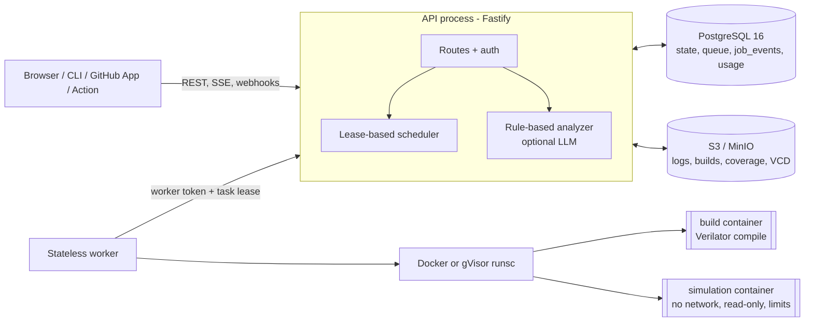

# VerifyCloud

**A self-hosted CI service for SystemVerilog: it runs Verilator regressions in locked-down containers and turns each failure into evidence (test, seed, assertion, waveform, coverage delta).**

[](https://github.com/siddhaantxsingh/VerifyCloud/actions/workflows/ci.yml?query=branch%3Accr-a6e6c567-y4w7k8)


[](verifycloud/LICENSE)

Software teams expect every pull request to be built, tested and explained. VerifyCloud gives RTL the same loop: a push or PR expands into a test × seed matrix, each build and simulation runs in a fresh sandbox, and the results land in a dashboard, CLI and API with logs, assertions, VCD waveforms and merged coverage. A rule-based analyzer points at the likely RTL line without any LLM; LLM help is opt-in.

**Status:** internally validated beta, not a production service. The real GitHub App, real LLM providers and a production deployment are not verified yet (see [Limitations](#limitations-and-status)).

## Highlights

- **Green CI on GitHub-hosted runners**: run [38740646066](https://github.com/siddhaantxsingh/VerifyCloud/actions/runs/38740646066) passed 157 tests (1 skipped, 158 total, 17 files) against PostgreSQL 16, real MinIO and the Docker sandbox, then started the Compose stack and passed the Playwright browser end-to-end test.
- **Hostile code stays in the sandbox**: no network, read-only root, all capabilities dropped, non-root, PID/memory/CPU/time limits. Adversarial testbenches (host `$fopen`, absolute `` `include ``, DPI-C calls into libc `system`/`unshare`, elaboration-time infinite loop, oversized design) pass 6/6 locally ([evidence](verifycloud/docs/evidence/2026-10-14/adversarial-rtl-2.log)).
- **Lease fencing tested with real worker processes**: SIGKILL mid-run, SIGSTOP past the lease (late writes refused), ±2 h clock skew and a 40-day clock step; each result is recorded once (`lease-real.test.ts` 3/3).
- **No double claims under load**: 0 tasks claimed twice in 8,080 claims; scheduler throughput 46.4–68.8 tasks/s on a 2-vCPU host ([benchmark report](verifycloud/docs/audit-2026-10-08/benchmark-report.md)).
- **The testbench catches real defects**: 9 of 10 injected RTL mutants detected; the miss is a documented testbench gap ([test report](verifycloud/docs/audit-2026-10-08/test-report.md#5-rtl-bug-injection-phase-7)).
- **Conservative analyzer**: on a labeled set of 28 analyses it gave 3 correct diagnoses, 25 abstentions and 0 wrong ones ([`ai-eval.json`](verifycloud/docs/benchmarks/ai-eval.json)).

## Architecture



The API never compiles or runs user code. Workers claim tasks over HTTP with a lease (fencing token); they hold no database or storage credentials, and a worker whose lease expired cannot commit a result. PostgreSQL is both the system of record and the queue (`FOR UPDATE SKIP LOCKED`), so results, coverage, usage and job state commit in one transaction. Live updates flow from `job_events` through `LISTEN/NOTIFY` to Server-Sent Events, with resume. Execution is at-least-once with fenced, idempotent result recording; it is not exactly-once ([ADR-008](verifycloud/docs/adr/ADR-008-leases-fencing-idempotency.md)).

More: [architecture.md](verifycloud/docs/architecture.md) · [database.md](verifycloud/docs/database.md) · [ADRs](verifycloud/docs/adr/).

## Quick start

Requirements: Docker with Compose, about 4 GB free RAM, Linux recommended.

```bash
git clone https://github.com/siddhaantxsingh/VerifyCloud.git
cd VerifyCloud/verifycloud
cp .env.example .env                  # replace every CHANGE-ME value
sudo mkdir -p /var/lib/verifycloud-worker
docker compose up --build
```

Open <http://localhost:8080> and log in with `DEMO_ADMIN_EMAIL` / `DEMO_ADMIN_PASSWORD` from `.env`. Behind a TLS-intercepting proxy, add `-f deploy/build-behind-proxy.yml` ([deployment.md](verifycloud/docs/deployment.md)).

Verified on 2026-10-14 with `postgres:16.10` and MinIO RELEASE.2025-04-22 (`bitnamilegacy/minio`, because `minio/minio` is no longer on Docker Hub): the demo regression ran end to end and 46 artifacts were byte-identical after restarting MinIO, PostgreSQL and the API ([compose-smoke-persist.log](verifycloud/docs/evidence/2026-10-14/compose-smoke-persist.log)).

Build and test from source (needs PostgreSQL and an S3 endpoint for the integration suites, see [testing.md](verifycloud/docs/testing.md)):

```bash
cd verifycloud
npm ci
npm run typecheck && npm run build
npm test                              # vitest; same suite CI runs
```

Host-process development without Compose: [local-development.md](verifycloud/docs/local-development.md).

### The demo: find a real bug in an AXI4-Lite block

The seeded project ([`examples/axi4lite-demo`](verifycloud/examples/axi4lite-demo)) has one intentional bug: read data is decoded from the live `ARADDR` instead of the address captured at the handshake, so `RDATA` changes while the master applies back-pressure.

1. Run the `full` regression: **FAILED**, 4/13 passed; `rw_overlap` and the `random` seeds fail; in the `random` runs the `rdata_stable` assertion fires.
2. Open a failing `random` run and click **Analyze**: the rule-based analyzer (no LLM) reports high confidence and cites `rtl/axil_regs.sv:131`, with the assertion and the waveform around the failure as evidence.
3. Verify the reference fix in a fresh run: **SUCCEEDED**, 13/13, with 0 newly failing tests in the comparison.

This exact flow is the browser end-to-end test ([`demo.spec.ts`](verifycloud/packages/web/e2e/demo.spec.ts)) that runs in CI against the Compose stack.

### Use it on your design

```yaml
# verifycloud.yaml
version: 1
project: { name: my-ip }
rtl: { sources: ["rtl/**/*.sv"] }
testbench: { sources: ["tb/*.sv"], top: tb_top }
simulator: { engine: verilator, timing: true, coverage: true, waveform: on_failure }
tests:
  smoke: {}
  random: { seeds: { range: [1, 20] } }
regressions:
  pr:   { tests: [smoke] }
  full: { tests: [smoke, random] }
resources: { cpu: 2, memory_mb: 2048, timeout_seconds: 600 }
```

```bash
verifycloud login --api http://localhost:8080
verifycloud validate
verifycloud run --project my-org/my-ip --regression pr --wait   # exit 0 pass, 1 fail, 3 timeout/infra
verifycloud logs <task-id> --errors
verifycloud coverage <job-id>
```

Reference: [verification-model.md](verifycloud/docs/verification-model.md) · [GitHub integration](verifycloud/docs/github-integration.md). Testbenches must work with Verilator 5.020; UVM is not supported.

## Results

Measured on 2026-10-10 on **one shared 2-vCPU cloud VM** that ran everything at once: API, PostgreSQL 16, an S3 emulator, workers, sandboxes and the load generator. Means of repeated runs; 95% confidence intervals are in the report. These are workload-specific numbers, not capacity promises.

| Measurement | Result | n |
| --- | --- | --- |
| Scheduler claims, no simulation, 1 / 5 / 10 / 25 workers | 46.4 / 65.5 / 68.8 / 64.4 tasks/s | 5 |
| Duplicate claims | 0 in 8,080 claims (no lease expired in this workload) | 20 runs |
| Real Verilator runs in sandboxes, 1 / 5 / 10 / 25 slots | 119 / 208 / 206 / 215 runs/min (CPU-bound at 2 vCPUs) | 3 |
| Sandbox container start + teardown | 0.23 s median (p95 0.27 s) | 20 |
| Demo build, cold / cache hit | 17.6 s / 0.015 s median | 5 |
| `GET /jobs/:id`, 10 concurrent clients | 784 req/s, p95 19 ms | 3 |

Earlier single-run figures (47.7 / 72.5 / 73.0 / 73.9 tasks/s; up to 245 runs/min) did **not** reproduce at 5 and 25 workers; the report says so and keeps both. Benchmarks were not re-run in the 2026-10-14 audit because the host was shared and heavily loaded.

Full method and raw data: [benchmark report](verifycloud/docs/audit-2026-10-08/benchmark-report.md) · [performance.md](verifycloud/docs/performance.md) · [`docs/benchmarks/`](verifycloud/docs/benchmarks/).

## How correctness is verified

| Layer | What runs | Evidence |
| --- | --- | --- |
| CI (every push / PR) | typecheck, build, simulation image, full vitest suite with PostgreSQL, MinIO and Docker; then Compose + Playwright | run [38740646066](https://github.com/siddhaantxsingh/VerifyCloud/actions/runs/38740646066): 157 passed, 1 skipped |
| Sandbox and adversarial RTL | hostile testbenches: network/DNS, writes, fork bomb, memory and output exhaustion, host-file reads, DPI-C into libc | `sandbox.test.ts`, `adversarial-rtl.test.ts` |
| Lease fencing | separate worker processes: SIGKILL, SIGSTOP past lease, clock skew and step | `lease-real.test.ts` 3/3 |
| Failure injection | API restart and object-storage outage during a running simulation: result recorded once | `recovery.test.ts` |
| Storage | 60 MB byte-exact round trip, Range reads, interrupted uploads, memory budget, MinIO restart | `audit-storage.test.ts` 4/4 |
| Property / fuzz | shared schemas and units with `fast-check` | [testing.md](verifycloud/docs/testing.md) |
| RTL mutation | 10 mutants on the demo design; 9 detected | [test report §5](verifycloud/docs/audit-2026-10-08/test-report.md#5-rtl-bug-injection-phase-7) |
| Failing-first fixes | each audit fix has a before/after log | [evidence/2026-10-14](verifycloud/docs/evidence/2026-10-14/) |

The 2026-10-14 audit tracks 22 requirements: 16 VERIFIED, 3 PARTIAL, 2 BLOCKED, 1 NOT RUN ([requirements matrix](verifycloud/docs/REQUIREMENTS_MATRIX.md)). It found and fixed, among others, a CI workflow that never ran, test credentials that made 65 of 143 tests fail against real MinIO, and unbounded worker-reported durations that could lose a result ([AUDIT_2026-10-14.md](verifycloud/docs/AUDIT_2026-10-14.md)).

## Design decisions

- **PostgreSQL as the queue, no Redis.** One store, transactional results, `SKIP LOCKED` claims under one advisory lock. Cost: a global claim lock caps throughput at roughly 64–69 claims/s on the test host, fine for second-long simulations. [ADR-002](verifycloud/docs/adr/ADR-002-postgres-queue.md), [ADR-003](verifycloud/docs/adr/ADR-003-no-redis-listen-notify.md)
- **One container per build and per test run.** Strong per-run limits and clean state at the price of ~0.23 s startup per run. Docker is not a VM-grade boundary, so worker hosts must be dedicated. [ADR-004](verifycloud/docs/adr/ADR-004-container-per-run-sandbox.md)
- **Leases with fencing tokens, at-least-once execution.** A run may execute twice after a partition, but only one result is ever recorded. [ADR-008](verifycloud/docs/adr/ADR-008-leases-fencing-idempotency.md)
- **One simulator behind an adapter harness.** Verilator only, done well, instead of thin wrappers around many. [ADR-005](verifycloud/docs/adr/ADR-005-verilator-adapter-harness.md)
- **Deterministic analysis first, LLM opt-in.** The analyzer abstains rather than guesses; LLM context is minimal, redacted and previewed. [ADR-007](verifycloud/docs/adr/ADR-007-ai-assistant-boundaries.md)
- **Waveforms indexed by the worker.** The browser shows the signals around the failure without downloading the whole VCD. [ADR-006](verifycloud/docs/adr/ADR-006-object-storage-and-waveform-index.md)

## Limitations and status

- **Blocked on owner accounts:** a real GitHub App on github.com (tested only against a local fake GitHub API with signed webhooks), real LLM providers (stub tests only), SMTP. Steps: [OWNER_ACTIONS.md](verifycloud/docs/OWNER_ACTIONS.md).
- **Partial:** gVisor (`runsc`) passes 5/6 selected sandbox tests and the adversarial cases; a fork-bombed container took over 20 s to remove. The output-directory budget is enforced by sampling and overshoots: 154 MiB for a 16 MiB budget on a GitHub runner (open finding F6).
- **One simulator:** Verilator 5.020 only; no UVM, no commercial simulators, VCD only (no FST).
- **Not claimed:** production deployment, multi-host scaling, exactly-once physical execution, SSO, billing-provider integration.
- **MinIO image** is an archived build (`bitnamilegacy/minio`) with no further security updates; choosing a long-term S3 service is an owner decision.
- **Lint** is `tsc --noEmit` only; test files are not type-checked.
- A compromised worker can falsify results of tasks it holds; container escape is mitigated by host dedication, not prevented. See [security.md](verifycloud/docs/security.md) and [threat-model.md](verifycloud/docs/threat-model.md).

## Repository layout

```text
.github/workflows/ci.yml   CI (runs inside verifycloud/)
verifycloud/
  packages/
    shared/   contracts, schemas, redaction, units
    server/   Fastify API, scheduler, auth, analyzer, GitHub/webhook integrations
    worker/   task loop, Docker/gVisor sandbox, Verilator harness, artifacts
    cli/      verifycloud command-line client
    web/      React dashboard
  deploy/     Dockerfiles, simulation image, proxy build override
  examples/   AXI4-Lite demo and GitHub Actions example
  action/     GitHub Action wrapper
  bench/      scheduler, sandbox, API, cost and analyzer benchmarks
  docs/       design, security, testing, ADRs, audits and evidence
```

## Documentation

| Topic | Documents |
| --- | --- |
| Design | [Architecture](verifycloud/docs/architecture.md) · [Database](verifycloud/docs/database.md) · [ADRs](verifycloud/docs/adr/) · [Scaling](verifycloud/docs/scaling.md) |
| Using it | [Local development](verifycloud/docs/local-development.md) · [Deployment](verifycloud/docs/deployment.md) · [Verification model](verifycloud/docs/verification-model.md) · [Simulator adapters](verifycloud/docs/simulator-adapters.md) · [Troubleshooting](verifycloud/docs/troubleshooting.md) |
| API | [API](verifycloud/docs/api.md) · [OpenAPI](verifycloud/docs/openapi.json) · [GitHub integration](verifycloud/docs/github-integration.md) |
| Security | [Security](verifycloud/docs/security.md) · [Threat model](verifycloud/docs/threat-model.md) · [Worker security](verifycloud/docs/worker-security.md) |
| Analysis and ops | [Failure analysis](verifycloud/docs/ai-debugging.md) · [Observability](verifycloud/docs/observability.md) |
| Testing and performance | [Testing](verifycloud/docs/testing.md) · [Performance](verifycloud/docs/performance.md) · [Benchmark report](verifycloud/docs/audit-2026-10-08/benchmark-report.md) |
| Audits | [Audit 2026-10-14](verifycloud/docs/AUDIT_2026-10-14.md) (includes scorecard) · [Requirements matrix](verifycloud/docs/REQUIREMENTS_MATRIX.md) · [Audit 2026-10-08](verifycloud/docs/audit-2026-10-08/README.md) · [Owner actions](verifycloud/docs/OWNER_ACTIONS.md) |

---

Built by [Siddhant Singh](https://github.com/siddhaantxsingh). Released under the [MIT License](verifycloud/LICENSE); the demo RTL is synthetic and written for this project.
