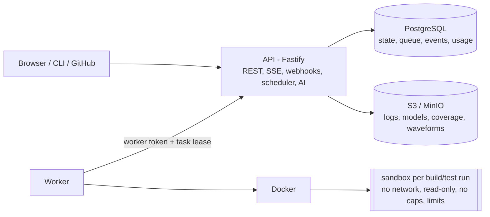

# VerifyCloud

**CI/CD, regression testing, coverage and AI-assisted debugging for RTL.**

VerifyCloud runs SystemVerilog regressions on every push and pull request,
in isolated sandboxes, and turns failures into evidence: which test and seed
failed, which assertion fired, the waveform around it, merged coverage and
what changed since the last run — and, if you want, a diagnosis and a patch
that is verified by running the regression again.

It is a production-oriented, self-hostable system built around one real
simulator backend (Verilator). Every number in this README was measured; every
claim that could not be tested here is marked as such.

| | |
| --- | --- |
| Simulator | Verilator 5.020 (verified). No other simulator is supported. |
| Execution | one locked-down Docker container per build/test run |
| Interfaces | web dashboard, REST API + OpenAPI, SSE, CLI, GitHub App, GitHub Action |
| Stack | TypeScript (Fastify, React), PostgreSQL, S3-compatible storage |
| Tests | 158 automated tests (vitest), run on GitHub Actions; status and evidence in [docs/AUDIT_2026-10-14.md](docs/AUDIT_2026-10-14.md) |

## Contents

* [Features](#features)
* [Architecture](#architecture)
* [Quick start](#quick-start)
* [The demo](#the-demo)
* [Using it on your design](#using-it-on-your-design)
* [Security model](#security-model)
* [Verification and test results](#verification-and-test-results)
* [Performance](#performance)
* [Known limitations](#known-limitations)
* [Roadmap](#roadmap)
* [Documentation](#documentation)

## Features

* **Regressions**: tests × seeds expanded into parallel runs; one cached build
  per job; per-run CPU, memory, time and disk limits; retries with flaky
  detection; cancellation; exact re-runs; reproduce-locally commands.
* **Results**: pass/fail decided by the simulator outcome; SVA assertion
  failures with file, line and simulation time; self-check markers; searchable
  logs (truncated safely); compare any two runs (newly failing, fixed, still
  failing, coverage delta, time).
* **Coverage**: line, branch, toggle and functional (cover properties) from
  Verilator, merged per job, per file with uncovered lines, per test run,
  history and drops (notifications).
* **Waveforms**: VCD captured on failure (configurable), indexed by the
  worker, viewed in the browser at the failure time without downloading the
  dump.
* **AI-assisted debugging**: a deterministic, evidence-backed rule-based
  analyzer by default; opt-in local or external LLMs with minimal, redacted
  context and a preview of exactly what is sent; patches verified by a fresh
  regression, never merged.
* **Multi-tenancy**: organizations, roles (owner/admin/engineer/viewer),
  personal access tokens and organization API keys with scopes, audit log,
  plan quotas, fair scheduling, billing-ready usage ledger, retention.
* **Integrations**: GitHub App (checks + commit status on push/PR), GitHub
  Action, email and signed webhooks, CLI.
* **Operations**: `/health`, `/ready`, Prometheus `/metrics`, structured logs
  with request ids, graceful worker draining, recovery from API, database and
  storage outages.

## Architecture



* The API never compiles or runs user code. Workers have no database or
  storage credentials; every call is bound to a task lease (fencing token).
* PostgreSQL is both the system of record and the queue
  (`FOR UPDATE SKIP LOCKED` under one advisory lock) — results, coverage,
  usage and job state commit together.
* Real-time updates: `job_events` + `LISTEN/NOTIFY` → Server-Sent Events with
  resume.

Details: [docs/architecture.md](docs/architecture.md) and the ADRs in
[docs/adr/](docs/adr/).

## Quick start

Requirements: Docker (with Compose), ~4 GB RAM free.

```bash
git clone <this repository> verifycloud && cd verifycloud
cp .env.example .env            # replace every CHANGE-ME value
sudo mkdir -p /var/lib/verifycloud-worker
docker compose up --build
```

Open <http://localhost:8080> and log in with `DEMO_ADMIN_EMAIL` /
`DEMO_ADMIN_PASSWORD` from `.env`.

> Verified on 2026-10-14 with `postgres:16.10` and MinIO RELEASE.2025-04-22
> (`bitnamilegacy/minio`, because `minio/minio` is no longer on Docker Hub):
> the demo regression ran end to end and artifacts survived restarts
> (`docs/evidence/2026-10-14/compose-*.log`). Behind a TLS-intercepting proxy,
> build with `deploy/build-behind-proxy.yml`.

Without Docker Compose (host processes, existing PostgreSQL and S3 endpoint):
see [docs/local-development.md](docs/local-development.md).

## The demo

The seeded project is a synthetic **AXI4-Lite register block** with one
intentional bug: read data is decoded from the live `ARADDR` instead of the
address captured at the handshake, so `RDATA` changes while the master
applies back-pressure. Nothing in the RTL hints at it.

1. Run the **full** regression → **FAILED**: 4/12 passed; all 8 `random`
   seeds fail on the `rdata_stable` assertion. Merged coverage (measured):
   line 7/7, branch 19/22, toggle 236/282, functional 9/9.
2. Open a failing run → **Analyze**: the rule-based analyzer (no LLM) reports
   that `rdata`/`rresp` are driven combinationally from `araddr` at
   `rtl/axil_regs.sv:131`, with the assertion, the RTL line and a waveform
   table as evidence (high confidence, both locations verified).
3. **Verify the reference fix in a fresh run** → **SUCCEEDED** 12/12;
   comparison: 8 fixed, 0 newly failing.

This exact flow is the browser end-to-end test (32 s with a warm build cache
on a 2-vCPU machine). Public deployments can enable `PUBLIC_DEMO=true`:
visitors get a temporary account that can run only this project.

## Using it on your design

```yaml
# verifycloud.yaml
version: 1
project: { name: my-ip }
rtl: { sources: ["rtl/**/*.sv"] }
testbench: { sources: ["tb/*.sv"], top: tb_top }
simulator:
  engine: verilator
  timing: true
  coverage: true
  waveform: on_failure
tests:
  smoke: {}
  random: { seeds: { range: [1, 20] } }
regressions:
  pr:   { tests: [smoke] }
  full: { tests: [smoke, random] }
resources: { cpu: 2, memory_mb: 2048, timeout_seconds: 600 }
```

Full reference: [docs/verification-model.md](docs/verification-model.md).

CLI:

```bash
verifycloud login --api https://verifycloud.example.com     # paste a personal access token
verifycloud validate
verifycloud run --project my-org/my-ip --regression pr --wait   # exit 0 pass, 1 fail, 3 timeout/infra
verifycloud status <job-id> ; verifycloud logs <task-id> --errors
verifycloud coverage <job-id> ; verifycloud artifacts <job-id> --download <id> --out file
```

GitHub: install the App and connect the repository (checks on every PR), or
use the Action in `action/` — [docs/github-integration.md](docs/github-integration.md).

## Security model

Simulation jobs are treated as hostile code. Each build and test runs in a
fresh container with no network, a read-only root and inputs, all
capabilities dropped, no-new-privileges, an unprivileged uid, an init
process, and PID, memory (no swap), CPU, disk, output and time limits — all
verified with hostile testbenches (network/DNS access, writes, fork bomb,
memory and output exhaustion, crashes).
Workers cannot reach the database or storage directly. Tenants are isolated
at every query (other organizations' resources return 404). Tokens and
sessions are stored hashed, secrets encrypted, GitHub tokens scoped to one
repository and never logged, webhooks HMAC-verified, outgoing webhooks
SSRF-guarded. The worker host itself controls Docker and must be dedicated.

[docs/security.md](docs/security.md) ·
[docs/threat-model.md](docs/threat-model.md) ·
[docs/worker-security.md](docs/worker-security.md)

## Verification and test results

81 automated tests (unit, property/fuzz, API, database, scheduler
concurrency, security, integrations, real-Docker sandbox, failure injection,
CLI) and 2 Playwright E2E tests — all passing in the latest run. Failure
injection showed an API restart, an object-storage outage and a PostgreSQL
restart during a running simulation each end with the result recorded once,
on the first attempt. [docs/testing.md](docs/testing.md) lists the critical
scenarios, the bugs these tests found, and what is not tested.

## Performance

Re-measured in the 2026-10 audit on a single 2-vCPU VM running everything
(API, PostgreSQL, S3 emulator, workers, load generator). Means of repeated
runs, with 95% confidence intervals in the
[benchmark report](docs/audit-2026-10-08/benchmark-report.md):

| Measurement | Result |
| --- | --- |
| Scheduler (no simulation), 1 / 5 / 10 / 25 workers, n=5 | 46.4 / 65.5 / 68.8 / 64.4 tasks/s; no task claimed twice in 8,080 claims (no lease expired in this workload) |
| Real Verilator runs in sandboxes, 1 / 5 / 10 / 25 slots (50 demo runs), n=3 | 119 / 208 / 206 / 215 runs/min (CPU-bound at 2 vCPUs) |
| Sandbox container start + teardown, n=20 | median 0.23 s |
| Demo build: cold / cache hit, n=5 | 17.6 s / 0.015 s |
| `GET /jobs/:id`, 10 concurrent clients, n=3 | 784 req/s, p95 19 ms |

The earlier single-run figures (47.7 / 72.5 / 73.0 / 73.9 tasks/s;
up to 245 runs/min) did not reproduce at 5 and 25 workers; the 10-worker
figure lies at the edge of the measured confidence interval.

Full tables and method: [docs/performance.md](docs/performance.md).

## Known limitations

* **One simulator**: Verilator only (2-state, no UVM in 5.020, SVA subset).
  No Questa/Xcelium/VCS/Icarus adapters.
* **Unverified**: real GitHub (tested against a fake API with signed
  webhooks), real LLMs (stub), AWS S3, multi-host scaling. gVisor is partly
  verified (fork-bomb cleanup is slow). No production deployment is claimed.
* The output-directory budget is enforced by sampling and can be overshot
  several-fold by a fast writer (audit F6).
* Global claim lock: ~64–69 claims/s on the test machine (fine for second-long
  simulations, not for millions of tiny tasks).
* Container escape on a worker host is mitigated by host dedication, not
  prevented; a compromised worker can falsify results of tasks it holds.
* VCD only (no FST); waveforms are capped in size; no distributed tracing;
  no billing provider integration (the usage ledger exists); no SSO/SAML.
* The partial SystemVerilog indexer is heuristic (regex/token based), used for
  navigation and analysis context only.

## Roadmap

1. Additional simulator adapters (Icarus; commercial simulators with license
   networking) and FST waveforms.
2. Scheduler: per-pool locks and batch claims; autoscaling workers on queue
   depth; Kubernetes manifests.
3. Stronger isolation by default: gVisor/Firecracker runtimes; signed results
   from attested workers.
4. Coverage closure tools: cross-run hole analysis, test ranking by unique
   coverage, regression minimization.
5. Formal (SymbiYosys) jobs and lint (Verible/Verilator lint) as job types.
6. SSO (OIDC/SAML), billing integration on top of the usage ledger.
7. Measured LLM evaluation on a corpus of seeded bugs before enabling
   LLM-generated patches by default.

## Documentation

| Topic | Document |
| --- | --- |
| Architecture | [docs/architecture.md](docs/architecture.md) |
| Local development | [docs/local-development.md](docs/local-development.md) |
| Deployment | [docs/deployment.md](docs/deployment.md) |
| Verification model and `verifycloud.yaml` | [docs/verification-model.md](docs/verification-model.md) |
| Simulator adapters | [docs/simulator-adapters.md](docs/simulator-adapters.md) |
| Worker security | [docs/worker-security.md](docs/worker-security.md) |
| Security | [docs/security.md](docs/security.md) |
| Threat model | [docs/threat-model.md](docs/threat-model.md) |
| API | [docs/api.md](docs/api.md), [docs/openapi.json](docs/openapi.json) |
| Database | [docs/database.md](docs/database.md) |
| AI debugging | [docs/ai-debugging.md](docs/ai-debugging.md) |
| GitHub integration | [docs/github-integration.md](docs/github-integration.md) |
| Observability | [docs/observability.md](docs/observability.md) |
| Scaling | [docs/scaling.md](docs/scaling.md) |
| Performance and cost | [docs/performance.md](docs/performance.md) |
| Testing | [docs/testing.md](docs/testing.md) |
| Troubleshooting | [docs/troubleshooting.md](docs/troubleshooting.md) |
| Decisions | [docs/adr/](docs/adr/) (ADR-001 … ADR-008) |
| Initial audit / final audit | [docs/AUDIT.md](docs/AUDIT.md), [docs/FINAL_AUDIT.md](docs/FINAL_AUDIT.md) |

## License

MIT — see [LICENSE](LICENSE). The demo RTL in `examples/axi4lite-demo` is
synthetic and written for this project.
