# AI-assisted debugging

Goal: from a failing run, get to the probable root cause quickly, with
evidence a verification engineer can check — and never pretend to know more.

## Flow

```mermaid
flowchart LR
  F[Failed run] --> C[Build context: log excerpt, assertion + property source, RTL driving the checked signals, waveform window]
  C --> R[Redact secrets and secret-like strings]
  R --> P{Provider}
  P -->|default| H[Rule-based analyzer]
  P -->|opt-in| L[LLM: local or external]
  H --> V[Validate: locations must exist in the job's sources]
  L --> V
  V --> D[Diagnosis: summary, root cause, locations, evidence, confidence, next steps]
  D --> X[Optional patch: AI-generated or user-written]
  X --> Y[Verification job: fresh sources + patch, full regression, isolated workers]
  Y --> Z[Compare with the failing run: fixed / still failing / newly failing]
```

## Context (what is used)

`packages/server/src/ai/context.ts` collects, for one failed run:

* log excerpt around the first error (bounded);
* the failed assertion(s) with file/line, and the source lines of the
  property;
* RTL lines that drive the signals the property checks, found with the
  partial SystemVerilog indexer (`assign`, `always_comb`, `always_ff`
  assignments, module ports), plus the module header;
* for `$stable(x)`-style properties: a window of the waveform before the
  failure for the involved signals and the inputs feeding the driver;
* for build failures: the first compiler errors and their source lines.

`GET /tasks/:id/analysis/preview` returns exactly this manifest (items and
sizes), the redactions, and where it would be sent. Total size is capped
(`AI_MAX_CONTEXT_BYTES`, default 48 KB). Entire repositories are never sent.

## Providers

| Provider | Data leaves the deployment | Configured by |
| --- | --- | --- |
| `heuristic` (default) | no | always available |
| `local` | no (OpenAI-compatible server inside the deployment, e.g. Ollama) | `AI_LOCAL_BASE_URL`, `AI_LOCAL_MODEL` |
| `openai` (any OpenAI-compatible API) | yes, the redacted excerpts | `AI_OPENAI_BASE_URL`, `AI_OPENAI_API_KEY`, `AI_OPENAI_MODEL`; project setting `allowExternal: true` |

The rule-based analyzer implements: R1 build failure (first error with its
source line), R2 assertion failure (property + drivers of the checked
signals), R2a stability rule (output driven combinationally from an input
that changed while the precondition held, shown in the waveform), R3 timeout,
R4 self-check failure. Every result it produces says it is not a language
model.

LLM prompts mark sources and logs as untrusted data in delimited blocks; the
model must answer in a JSON schema. Answers are validated: unknown files or
line numbers are marked `verified: false`, and confidence is lowered.

## Patches

* AI patches (LLM providers only) and user patches are unified diffs, parsed
  strictly and checked against the job's sources (must apply, may only touch
  existing files).
* **Verify** starts a new job: same configuration and source, patch applied
  to a fresh copy, run in isolated workers. The UI then shows the comparison
  with the failing run.
* VerifyCloud never pushes, merges or opens pull requests. An AI patch is
  labelled "AI-generated — unverified until a verification run passes" even
  after it passes: passing the regression is evidence, not proof.

## Demo result (measured)

On the seeded AXI4-Lite design, the `full` regression fails the `rw_overlap`
test and all `random` seeds (`rdata_stable` fires); the other directed tests
pass. The rule-based analyzer reports:

> rdata and rresp are driven combinationally (always_comb) from the module
> input araddr (rtl/axil_regs.sv:131). When araddr changes while the
> handshake is pending, the outputs change too, which rdata_stable forbids.

with high confidence, both locations verified, and a waveform table showing
`araddr` changing while `rvalid=1, rready=0`. The shipped reference fix
(`examples/axi4lite-demo/fix-rdata-stable.patch`) verified in a fresh job:
all runs pass (13/13 since the 2026-10 audit, which also corrected the fix:
RDATA is now registered at the AR handshake). This exact flow runs in the
browser E2E test (`packages/web/e2e/demo.spec.ts`).

## Labeled evaluation (2026-10 audit)

`bench/ai-eval.ts` injects 11 single defects (plus a syntax error) into the
demo design, runs each as a real regression (Verilator in the sandbox) and
analyzes one failing run per failing test through the API. Result
(docs/benchmarks/ai-eval.json): the testbench detects 11 of 12 cases. Of 28
analyses, 3 are correct (root cause stated and the defect line cited: the
shipped bug twice, the syntax error once), 25 abstain with "insufficient
evidence", **0 are wrong**. A cited location is near the defect in 5 of 28.
In short, the analyzer is precise but has low coverage: it recognises
combinational-stability bugs and compiler errors; scoreboard mismatches get
next steps, not a diagnosis.

## Limits

* The rule-based analyzer covers the patterns above; other failures get an
  "insufficient evidence" answer with next steps, not a guess.
* LLM integration was tested against a local stub server (no API key was
  available): request format, redaction, validation, token accounting. The
  quality of real model answers is **unmeasured**.
* Metrics: `ai_analysis_latency_seconds`, `ai_analysis_failures_total`; usage:
  `ai_tokens_in/out` in the ledger, capped per plan.
