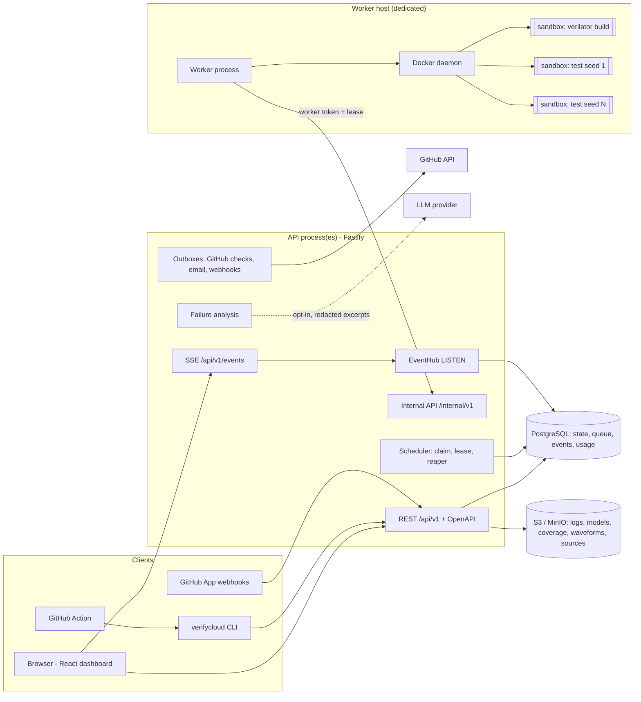
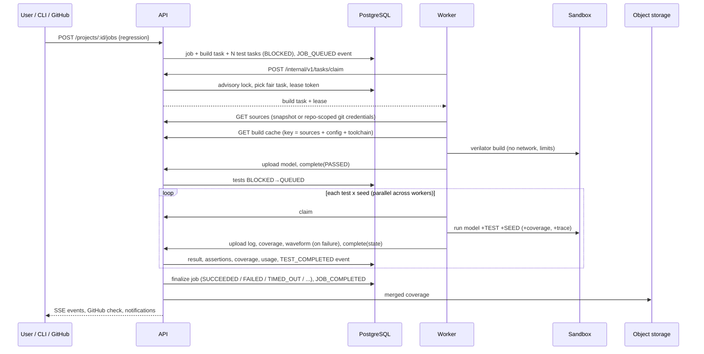

# Architecture

VerifyCloud runs RTL verification (build, regression, coverage, failure
analysis) for many organizations on shared infrastructure without trusting
their code.

## Components

| Component | Responsibility | Code |
| --- | --- | --- |
| API | auth, tenancy/RBAC, projects, jobs, artifacts, coverage, compare, AI, webhooks, SSE, metrics | `packages/server` |
| Scheduler | job → tasks expansion, fair claim, leases, retries, cancellation, timeouts, finalization | `packages/server/src/scheduler.ts` |
| Worker | fetch sources, build once, run tests, collect logs/coverage/waveforms, enforce limits | `packages/worker` |
| Sandbox | one container per build/test run (ADR-004) | `packages/worker/src/sandbox.ts` |
| Simulator adapter | Verilator command lines, harness, output/coverage parsing | `packages/worker/src/adapters` |
| Shared | config schema, coverage, SV indexer, VCD, patches, tar | `packages/shared` |
| CLI | `verifycloud` | `packages/cli` |
| Web | dashboard | `packages/web` |

## Life of a regression

## States

Job: `QUEUED → RUNNING → SUCCEEDED | FAILED | CANCELLED | TIMED_OUT | RESOURCE_EXCEEDED | ERROR`.

Task: `BLOCKED` (waiting for the build) `→ QUEUED → RUNNING → PASSED | FAILED |
ERROR | TIMED_OUT | RESOURCE_EXCEEDED | CANCELLED | SKIPPED`.

Job finalization rule (in order): cancellation requested → `CANCELLED`; build
did not pass → the build's state (`FAILED`/`TIMED_OUT`/`RESOURCE_EXCEEDED`);
any test `FAILED`/`ERROR` → `FAILED`; any `TIMED_OUT` → `TIMED_OUT`; any
`RESOURCE_EXCEEDED` → `RESOURCE_EXCEEDED`; otherwise `SUCCEEDED`. A job past
its plan's maximum duration is finalized `TIMED_OUT` by the reaper.

## Trust boundaries

1. Internet → API: authenticated users/tokens; webhooks verified by HMAC.
2. API → worker: workers are semi-trusted infrastructure with a narrow API
   and no database/storage credentials.
3. Worker → sandbox: **untrusted**. Everything inside a sandbox is assumed
   hostile (ADR-004, docs/worker-security.md).
4. API → LLM provider: opt-in, minimal, redacted (ADR-007).

## Data

PostgreSQL holds all state (schema: docs/database.md). Object storage holds
blobs. Nothing durable lives on API or worker disks: both are stateless and
can be replaced at any time (workers drain on SIGTERM; leases cover crashes).

## What is not here

No Kubernetes manifests, no multi-region setup, no billing provider, no
commercial simulator adapters. See docs/scaling.md and the roadmap in the
README.
