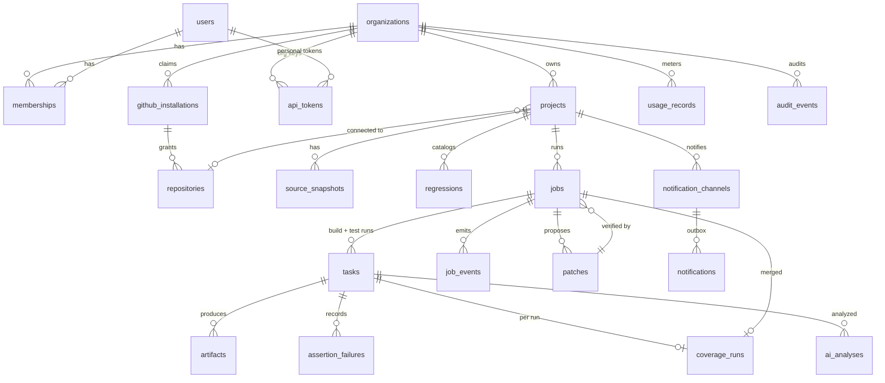

# Database

PostgreSQL 16. Schema: `packages/server/src/migrations/001_init.sql`
(forward-only migrations, applied at API start under advisory lock
7471001; applied versions in `schema_migrations`).

## Tables

| Table | Purpose / notable columns |
| --- | --- |
| `plans` | quotas per plan: concurrent jobs/tasks, max job seconds, artifact quota, runs per job, AI tokens, max retention per artifact kind (`free`, `pro`, `demo`) |
| `users`, `sessions`, `email_tokens`, `oauth_states` | accounts; sessions/tokens/states stored as SHA-256 hashes; scrypt password hashes |
| `organizations`, `memberships` | tenants and roles (`owner`, `admin`, `engineer`, `viewer`) |
| `api_tokens` | PATs and org keys: prefix, hash, scopes, expiry, last use, revocation |
| `github_installations`, `repositories`, `branches`, `commits` | GitHub App installations (with the installing GitHub login), repositories, refs seen |
| `projects` | config path, default branch, concurrency cap, retention, AI settings, PR checks |
| `project_secrets` | AES-256-GCM ciphertext + nonce |
| `source_snapshots` | uploaded trees: artifact, sha256, file count, config text |
| `regressions`, `test_cases` | catalog used by dashboards and "Run" buttons |
| `jobs` | regression run: trigger, source, resolved config + sha256, toolchain, state, summary, merged coverage, deadline, GitHub check id, parent job and patch for verifications, idempotency key |
| `tasks` | build and test runs: state, attempt/max_attempts, lease (worker, token, expiry), resources, plusargs, seed, result JSON, flaky attempts, model artifact |
| `assertion_failures` | name, scope, file, line, sim time, message per failing run |
| `coverage_runs` | per run and merged per job: covered/total for line, branch, toggle, functional; detail artifact |
| `artifacts` | blobs in object storage: kind, key, size, sha256, encoding, expiry; `storage_gc` trigger on delete |
| `storage_gc` | object keys to delete (guarantees objects are deleted after their rows) |
| `build_cache` | (org, content key) → model artifact |
| `workers` | registered workers, token hash, capacity, toolchain, heartbeat, state |
| `job_events` | ordered events for SSE replay (`NOTIFY vc_events`) |
| `ai_analyses`, `patches` | analyses (provider, context manifest, result, tokens, latency) and patches (origin `ai`/`user`, diff, files) |
| `notification_channels`, `notifications`, `webhook_deliveries` | outgoing notification outbox (status, attempts, backoff) and de-duplicated incoming GitHub deliveries |
| `usage_records` | billing-ready ledger: kind (`worker_seconds`, `simulation_seconds`, `cpu_seconds`, `artifact_bytes`, `ai_tokens_in/out`, …), quantity, unique `source_key` (idempotent) |
| `audit_events` | actor, action, target, IP, request id, metadata |
| `rate_limits` | fixed-window counters |

## Integrity rules worth knowing

* Every tenant-owned row carries `org_id`; API loaders always join on the
  caller's memberships.
* Queue indexes: `tasks(queued_at) WHERE state='QUEUED'`,
  `tasks(lease_expires_at) WHERE state='RUNNING'`,
  `tasks(org_id) WHERE state='RUNNING'` keep claim and reaper queries on small
  partial indexes.
* Usage records are inserted with `ON CONFLICT (source_key) DO NOTHING`, so a
  retried completion never double-bills.
* Deleting a project cascades to its rows; the artifact delete trigger queues
  every object for removal.

## Tested

`packages/server/test` creates a fresh database per test file and exercises
migrations, constraints and the queue under concurrency (scheduler tests,
idempotency under 8 concurrent requests, lease expiry, reaper), plus a
PostgreSQL restart during a running simulation (recovery test).
