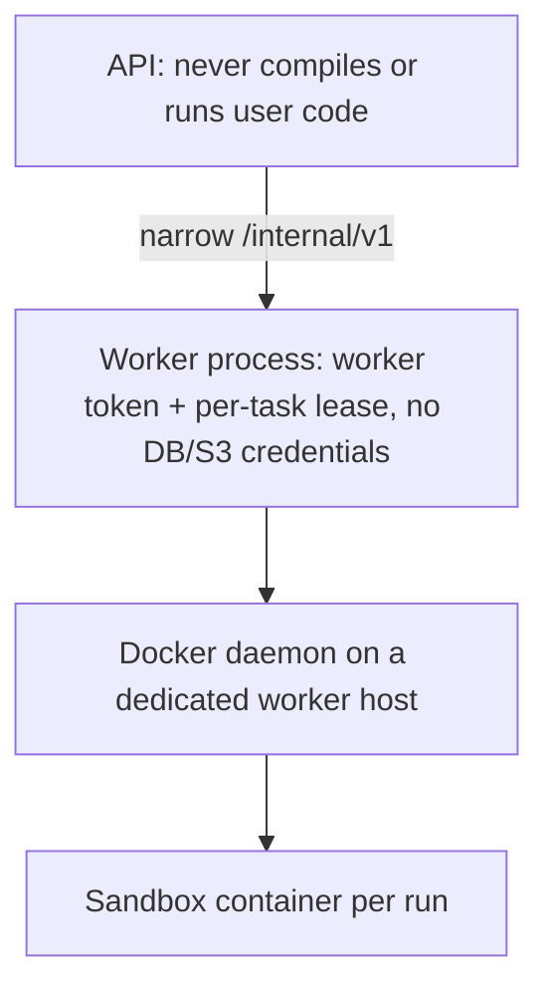

# Worker and sandbox security

Simulation jobs are untrusted workloads. Verilator compiles user SystemVerilog
to C++ and runs it; `$system`, DPI-C and C++ in testbenches give arbitrary
code execution inside the run. The design assumes every build and test run is
hostile.

## Layers

### Sandbox container (every build and every test run)

| Control | Setting | Purpose |
| --- | --- | --- |
| Network | `--network none` | no exfiltration, no license-server abuse, no lateral movement |
| Filesystem | `--read-only`; sources, harness files, model mounted read-only; one writable output dir (size-monitored); `/tmp` tmpfs 64 MiB `noexec,nosuid`; scratch tmpfs (`disk_mb`) | no persistence, no tampering with inputs |
| Identity | `--user 10001:10001` | not root inside the container |
| Privileges | `--cap-drop ALL`, `--security-opt no-new-privileges`, Docker default seccomp profile | no capabilities, no setuid escalation, dangerous syscalls blocked |
| Process | `--init` (PID 1 reaps and forwards signals), `--pids-limit` (default 512) | fork bombs contained |
| Memory | `--memory` = `--memory-swap` = task memory | no swap thrash; OOM → `RESOURCE_EXCEEDED` (Docker's OOMKilled flag) |
| CPU | `--cpus` = task CPUs | fair sharing on the host |
| Files | `--ulimit nofile=4096`, `core=0` | |
| Time | worker kills the container at the task timeout | `TIMED_OUT` |
| Output | first `MAX_LOG_BYTES` kept; beyond `HARD_OUTPUT_BYTES` the run is killed and the client detached | output floods cannot exhaust worker memory or block the event loop |
| Output dir | size polled every second; over `MAX_OUT_DIR_BYTES` → killed | huge waveforms/coverage |
| Environment | only what the run needs; no tokens or secrets | |
| Logging | `--log-driver none` | the daemon does not store output |
| Optional | `SANDBOX_RUNTIME=runsc` (gVisor) | user-space kernel between the run and the host kernel |

Containers are named `vc-<random>`, removed after every run (also after
kills), and never reused.

### Worker process

* Registers once with `WORKER_REGISTRATION_TOKEN`, receives its own token
  (stored hashed by the API).
* Every task operation requires the task's current lease token; a worker can
  only touch tasks it holds.
* Downloads exactly the artifacts referenced by its task (model, sources),
  uploads artifacts bound to its task, size-limited by the API.
* For GitHub sources it requests a short-lived installation token limited to
  that one repository, fetches the exact commit with credentials in an HTTP
  header (not in the URL), hooks and credential helpers disabled, then
  deletes the clone's `.git`. Symlinks in sources are refused. The token never
  enters a sandbox and is redacted from logs.
* Source/config errors are reported as user errors; anything unexpected is an
  infrastructure error and the task is retried elsewhere.
* Everything the simulation leaves in its output directory is untrusted: the
  worker opens result files (coverage, waveform, compiled model) with
  `O_NOFOLLOW | O_NONBLOCK`, accepts only regular files within a size limit,
  and scans the directory with entry and depth bounds (`safefs.ts`). Before the
  2026-10 audit, a planted symlink made the worker upload host files (C1) and
  a FIFO hung it (C2).
* Sandbox containers are labelled with the worker's identity; a restarted
  worker removes containers left by its previous run and wipes its own work
  directory.
* Simulator flags are canonicalised before the deny-list check (single-dash
  spellings, `+incdir+`, `-CFLAGS`, `-o`, `-Mdir` …), and `vc_*` plusargs are
  reserved for the harness.
* Git credentials are passed through `GIT_CONFIG_*` environment variables (not
  `argv`); the commit sha and https URL are validated.

### Worker host

The worker uses the host's Docker daemon. **Access to the Docker socket is
root-equivalent on that host.** A sandbox escape (a kernel or runtime bug)
would compromise the worker host, so:

* run workers on dedicated VMs (one tenant pool per VM if tenants must be
  isolated from each other even against escapes);
* put nothing else on worker hosts: no database or cloud credentials, no SSH
  keys to other systems;
* restrict egress of the worker host to the API endpoint (and the registry
  for image pulls);
* prefer rootless Docker or `runsc` (gVisor) where the workload tolerates it;
* keep the kernel and Docker updated; rebuild the simulator image regularly.

The `process` sandbox (plain subprocess with ulimits) exists for local
development only. It provides **no** isolation, is refused unless
`ALLOW_UNSAFE_PROCESS_SANDBOX=true`, and its toolchain is reported as such.

## Verified behavior

From `packages/worker/test/sandbox.test.ts` (real Docker 29.8.2, real
Verilator 5.020, executed in this environment):

| Hostile behavior in the testbench | Observed |
| --- | --- |
| TCP connect to 1.1.1.1:80 | blocked |
| DNS lookup of github.com | fails |
| `touch /work/src/pwn` | read-only |
| `touch /usr/pwn` | read-only |
| `id -u` | 10001 |
| `CapEff` | `0000000000000000` |
| `/var/run/docker.sock` | absent |
| copy a binary to /tmp and execute | not permitted (`noexec`) |
| look for tokens/secrets in env | none |
| fork bomb + 400 background processes | PID limit hit; container removed; same worker runs the next job |
| allocate memory without bound (`memory_mb: 512`) | `RESOURCE_EXCEEDED` (memory limit of 512 MiB) |
| print without end | killed, log truncated, `RESOURCE_EXCEEDED` |
| simulation that never finishes | `TIMED_OUT` after 5 s limit |
| `kill -SEGV` of the simulator | `FAILED`, exit code 139, not retried |

Not tested here: kernel exploits/container escapes, gVisor (`runsc` not
installed), rootless Docker, side channels between co-located sandboxes.
